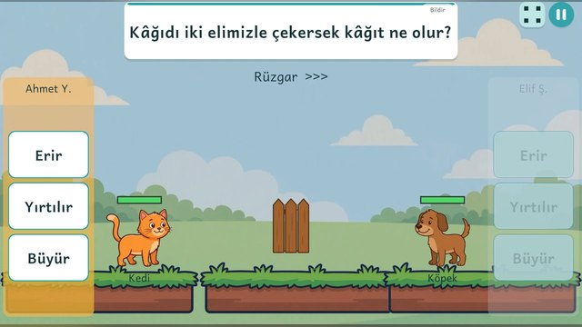
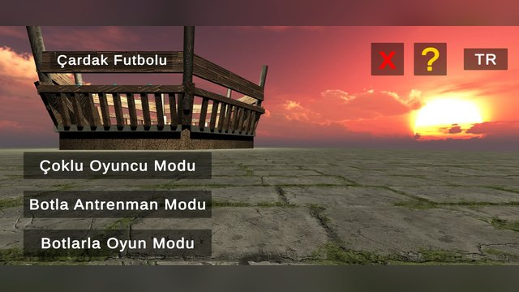
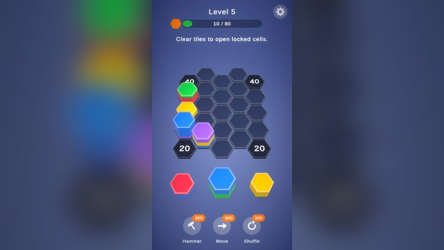
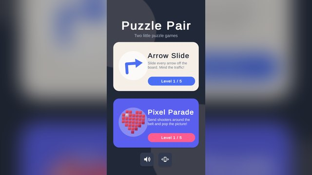
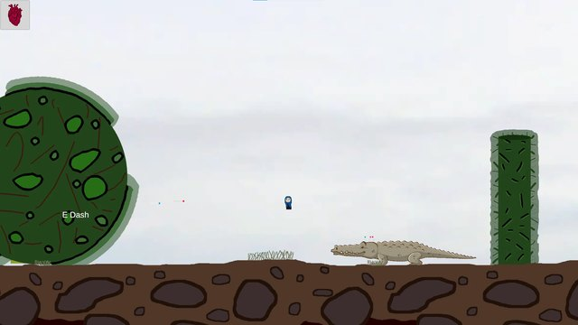
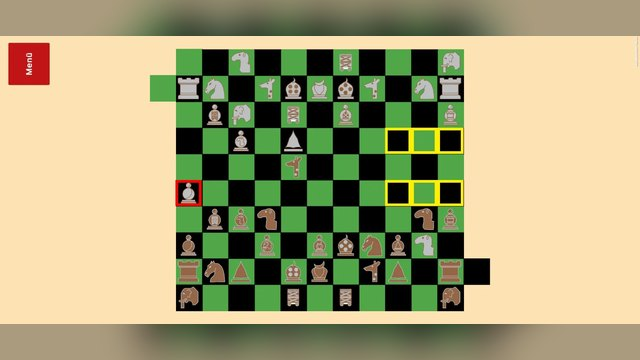
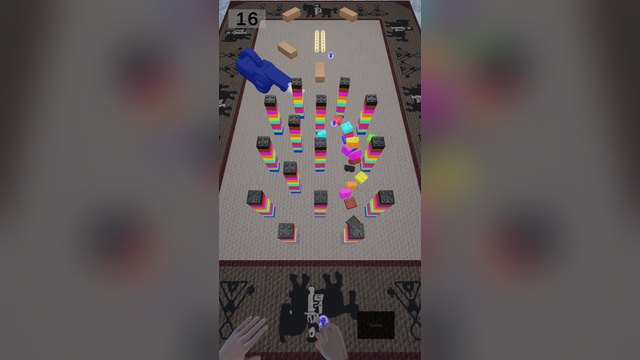
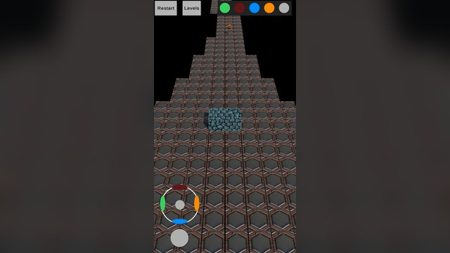
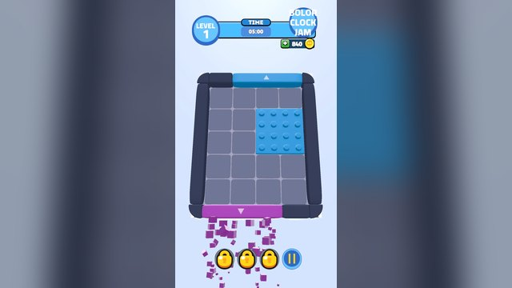

## Hi, I'm Burak Ünye 👋

**Unity Developer · C#** · Istanbul, Türkiye

I'm a computer engineer building mobile, WebGL and multiplayer games with Unity and C#. I've worked on online multiplayer (Photon Fusion 2), AI agents (Unity ML-Agents) and educational games. I'm currently building **ReyMektebi**, a smart-board game platform for primary schools.

🌐 **Portfolio with screenshots:** [burak-unye.vercel.app](https://burak-unye.vercel.app)

**Tech:** Unity (2D/3D, URP) · C# · Photon Fusion 2 · ML-Agents · WebGL & Android builds · level design & editor tools · Git · Blender · Illustrator · Next.js

---

### Projects

<table>
<tr>
<td width="33%" valign="top">

<b><a href="https://burak-unye.vercel.app/#reymektebi">ReyMektebi</a></b> 
Curriculum-based game platform for classroom smart boards: 40+ mini games, 19,000+ questions, multi-touch for two players. 
Main project · pre-release · closed source
</td>
<td width="33%" valign="top">

<b><a href="https://github.com/Burak168ny/Gazebo-Soccer">Gazebo Soccer (Çardak Futbolu)</a></b> 
Graduation project. Online soccer on a hexagonal field: 3D version with ML-Agents bots, 2D version with host migration. 
Photon Fusion 2 · ML-Agents · ProBuilder
</td>
<td width="33%" valign="top">

<b><a href="https://github.com/Burak168ny/hexa-sort-clone">Hexa Sort (clone)</a></b> 
100 levels balanced with a simulation bot, engine-free tested C# core and a level editor. 
Mobile puzzle · tests · editor tools
</td>
</tr>
<tr>
<td width="33%" valign="top">

<b><a href="https://github.com/Burak168ny/puzzle-pair">Puzzle Pair: Arrow Slide & Pixel Parade</a></b> 
Two puzzle games inspired by Arrows – Puzzle Escape and Pixel Flow!, with original art and sound. 
Mobile puzzle · 51 EditMode tests
</td>
<td width="33%" valign="top">

<b><a href="https://github.com/Burak168ny/TeacHer">TeacHer</a></b> 
40-level 2D platformer about students' stress, anxiety and laziness, with ML-Agents enemies. 
ML-Agents · pixel art
</td>
<td width="33%" valign="top">

<b><a href="https://github.com/Burak168ny/Tamerlane-Chess-and-Table-Games">Tamerlane Chess & board games</a></b> 
Tamerlane chess on an 11x10 board, plus Quoridor and Dots and Boxes. My first game. 
2D strategy · Illustrator art
</td>
</tr>
<tr>
<td width="33%" valign="top">

<b><a href="https://github.com/Burak168ny/Bilye">Bilye (Marbles)</a></b> 
3D marble-flicking physics game with a throw queue and saved marble inventory. 
3D physics · mobile
</td>
<td width="33%" valign="top">

<b><a href="https://github.com/Burak168ny/Block-Road">Block Road</a></b> 
Block-rolling puzzle with elemental forms and JSON-loaded level sections. 
3D puzzle · JSON levels
</td>
<td width="33%" valign="top">

<b><a href="https://github.com/Burak168ny/Bolor-Clock-Jam-klon-">Color Block Jam (clone)</a></b> 
Built during my internship at Omicron Games: drag-out block puzzle with JSON level loading. 
Mobile puzzle · internship
</td>
</tr>
</table>

More: [Sky Roller (clone)](https://github.com/Burak168ny/Sky-Roller-klon-) · [Kapak](https://github.com/Burak168ny/Kapak) · [Propellers](https://github.com/Burak168ny/Propellers) · [ReyDress](https://github.com/Burak168ny/ReyDress)

---

🇹🇷 Bilgisayar mühendisiyim; Unity ve C# ile mobil, WebGL ve çok oyunculu oyunlar geliştiriyorum. Ekran görüntülü portfolyom: <a href="https://burak-unye.vercel.app">burak-unye.vercel.app</a>
